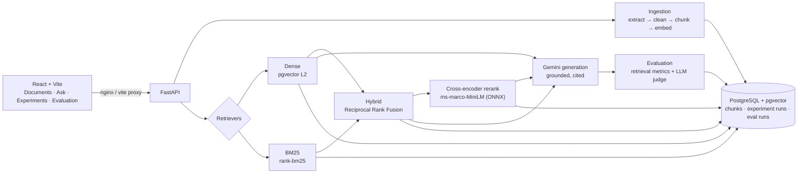

# RAGOps

A RAG experimentation and evaluation platform. Upload documents, ask grounded
questions with citations, and **measure** how much each retrieval strategy
actually helps: Baseline → Dense → Hybrid (Dense + BM25) → Hybrid + Cross-Encoder
reranker, compared on one shared, page-labelled benchmark with retrieval
metrics (Recall@K, Precision@K, MRR, nDCG@K) and LLM-judged generation metrics
(faithfulness, answer/context relevance, citation accuracy), plus latency.

The project plan this implements is in [docs/RAGOps_2_Person_Project_Plan.pdf](docs/RAGOps_2_Person_Project_Plan.pdf).

- [Architecture](#architecture)
- [Quickstart](#quickstart)
- [Using it](#using-it)
- [Benchmark results](#benchmark-results)
- [How it works](#how-it-works)
- [API](#api)
- [Configuration](#configuration)
- [Development](#development)
- [Plan coverage](#plan-coverage)
- [Limitations](#limitations)

## Architecture



Everything is one FastAPI service, one Postgres database and one static
frontend, as the plan asks: no microservices, no orchestration layer.

## Quickstart

Requirements: Docker, and a Gemini API key from [Google AI Studio](https://aistudio.google.com/).

```bash
cp .env.example .env          # set GEMINI_API_KEY and EVAL_API_KEY
docker compose up --build
```

| Service | URL |
|---|---|
| Web app | http://localhost:5173 |
| API + Swagger docs | http://localhost:8000/docs |
| Postgres (pgvector) | localhost:5432 |

The backend image bakes in the cross-encoder model at build time, so the first
build takes a few minutes and the containers then run offline apart from
Gemini calls. See [docs/DEPLOYMENT.md](docs/DEPLOYMENT.md) for running it on a
server.

## Using it

1. **Documents** (`/library`): upload a text-based PDF. It is extracted, cleaned,
   chunked and embedded into pgvector, keeping the file name and page number of
   every chunk.
2. **Ask** (`/ask`): ask a question. Dense retrieval picks the closest chunks and
   Gemini answers only from them, citing `[Source N]` for each claim; citations
   link to the source chunk.
3. **Experiments** (`/experiments`): run one query through Dense, BM25, Hybrid,
   Hybrid + Cross-Encoder and Baseline side by side. Retrieval only, so it is
   fast and free of generation cost. Shows rankings, scores, which chunks the
   retrievers agree on, and latency. Runs and named configurations are stored.
4. **Evaluation** (`/evaluation`): "Load shared benchmark" and run it (needs the
   `EVAL_API_KEY`) to score all four configurations, or browse earlier runs
   question by question, with the judge's reasoning for every score.

To reproduce the benchmark below: upload
`backend/benchmarks/beir-2104.08663v4.pdf`, then

```bash
pip install -r scripts/requirements.txt
python scripts/run_benchmark.py            # --limit 2 for a quick smoke test
```

## Benchmark results

The full results (tables per configuration and per question type, plus
charts) are written to [docs/benchmarks/results.md](docs/benchmarks/results.md)
by `scripts/run_benchmark.py`. The full run makes about 440 Gemini calls, so it
needs a key with a paid-tier quota: the free tier allows only 20 generation
requests per day for `gemini-3.6-flash`.

How to read the numbers, and the analysis, are in [docs/REPORT.md](docs/REPORT.md#3-results).

## How it works

### Ingestion

`POST /documents/upload/` validates the file (PDF, ≤10 MB), then
`app/ingestion.py` runs the pipeline:

1. **Extract** page by page with `pypdf`, keeping the 1-based page number.
2. **Clean** (`app/utils.clean_text`): rejoin hyphenated line breaks, turn soft
   wraps into spaces, collapse whitespace, keep paragraph breaks.
3. **Chunk** each page separately into 500-character chunks with 50 characters
   of overlap, so every chunk has exactly one page number.
4. **Embed** in batches with `gemini-embedding-001` (768 dimensions,
   `RETRIEVAL_DOCUMENT` task type) and store in a pgvector column.

### Retrieval strategies

All live in `app/rag_pipelines.py`. Each has a `retrieve_*` function (ranked
chunks with scores, used by the experiments) and a `run_*` pipeline (retrieval
plus cited generation, used by the benchmark).

| Strategy | How | Score |
|---|---|---|
| **Baseline** | Top-K pgvector L2 search, no filtering | L2 distance |
| **Dense** | Top-8 by L2, drop chunks beyond the distance gate (0.8), keep top-K | L2 distance |
| **BM25** | `BM25Okapi` over all chunks (experiments only) | BM25 |
| **Hybrid** | Dense top-8 and BM25 top-8 fused with Reciprocal Rank Fusion (k=60) | RRF |
| **Hybrid + Cross-Encoder** | Hybrid top-8 re-scored by `ms-marco-MiniLM-L-6-v2` | logit |

Why these choices:

- **RRF instead of a weighted score sum.** L2 distances and BM25 scores live on
  unrelated scales, and RRF only uses ranks, so it needs no normalisation or
  tuning.
- **A cross-encoder for reranking.** A bi-encoder embeds the question and the
  chunk separately. A cross-encoder reads them together, so it judges relevance
  more precisely, but it needs one model pass per candidate. That is why it only
  re-scores the 8-chunk hybrid pool. It runs locally through fastembed's ONNX
  runtime, with no PyTorch, no API cost, and deterministic scores. This is the
  setup the BEIR paper found best for zero-shot retrieval.
- **Failure policy.** A strategy that fails raises an error and is recorded as
  failed. It never silently falls back to another strategy, because that result
  would be filed under the wrong label.

### Generation

The Ask page uses `app/rag_pipeline.py` (dense retrieval, `[Source N]`
citations). The benchmark pipelines cite chunk IDs as `[chunk_id]` so citations
can be checked mechanically. Both prompts allow answering only from the
retrieved context, and require a fixed "cannot find" sentence when the context
is insufficient. Generation uses `gemini-3.6-flash`.

### Evaluation

`POST /api/eval/run` runs each benchmark question through each configuration,
then measures two things:

- **Retrieval metrics** (`app/eval_retrieval.py`) on the K=3 chunks handed to the
  generator, against page labels. A chunk counts as relevant if it comes from a
  labelled page of the labelled file. Labels are page numbers, not chunk IDs,
  because chunk IDs change every time a PDF is re-uploaded.
  - **Precision@K**: relevant chunks in the top K, divided by K.
  - **Recall@K**: labelled pages hit, using BEIR's capped recall.
  - **MRR**: the reciprocal rank of the first relevant chunk.
  - **nDCG@K**: binary-gain DCG divided by the ideal DCG.
- **Generation metrics** (`app/eval_generation.py`), scored 0–1 by a Gemini
  LLM-as-judge at temperature 0, with written reasoning stored for every score:
  - **Faithfulness**: is every claim supported by the context?
  - **Answer relevance**: does the answer address the question?
  - **Context relevance**: how much of the retrieved context is useful?
  - **Citation accuracy**: do the cited chunks support the claims next to them?
    A citation of a chunk that was never retrieved caps this score at 0.2,
    regardless of what the judge said.

  The overall score is a weighted mean: faithfulness .35, citation .25, the two
  relevance metrics .20 each.

Judge failures raise an error rather than recording a default score, so a run
either has measured numbers or is marked failed.

### Benchmark dataset

`backend/benchmarks/ragops_benchmark.json`: 22 questions about the BEIR paper
(arXiv:2104.08663, CC BY-SA 4.0, included unmodified), each with a reference
answer and the pages that answer it. The questions are a mix of three types:

- **Factual**: the question restates the paper's wording.
- **Keyword**: the question hinges on exact names and numbers, where BM25
  should help.
- **Paraphrase**: the question shares little vocabulary with the text, where
  dense retrieval should help.

Every label was checked against the extracted page text. See
[backend/benchmarks/README.md](backend/benchmarks/README.md).

## API

Full interactive docs at `/docs`. Summary:

| Method | Path | Purpose |
|---|---|---|
| POST | `/documents/upload/` | Upload and index a PDF |
| GET | `/documents/files` | One row per indexed file |
| DELETE | `/documents/by-file/{file_name}` | Remove a file's chunks |
| GET | `/documents/` · DELETE `/documents/{id}` | Raw chunks |
| POST | `/query/` | Grounded answer + sources |
| POST | `/api/experiments/compare` | Rank one query with several retrievers |
| GET | `/api/experiments/runs` | Experiment history |
| GET/POST/DELETE | `/api/experiments/configs` | Saved experiment configurations |
| POST | `/api/eval/run` | Run the benchmark (requires `X-API-Key`) |
| GET | `/api/eval/compare` | Latest completed run per configuration |
| GET | `/api/eval/results/{run_id}` | Per-question scores and judge reasoning |
| GET | `/api/eval/benchmark` | The shared benchmark dataset |

## Configuration

Set in `.env` (see [.env.example](.env.example)); defaults live in `backend/app/config.py`.

| Variable | Default | Purpose |
|---|---|---|
| `GEMINI_API_KEY` | required | Embeddings, generation, judge |
| `EVAL_API_KEY` | required for evaluation | Shared secret for `POST /api/eval/run`; without it that endpoint returns 503 |
| `DATABASE_URL` | set by compose | PostgreSQL connection string |
| `LLM_MODEL` | `gemini-3.6-flash` | Generation and judge model |
| `GEMINI_JUDGE_MODEL` | `LLM_MODEL` | Use a different judge model |
| `EMBEDDING_MODEL` | `gemini-embedding-001` | Embedding model (768-d) |
| `RAG_TOP_K` | `5` | Chunks retrieved by the Ask page |
| `RAG_MAX_DISTANCE` | `0.8` | L2 distance gate |
| `RERANKER_MODEL` | `Xenova/ms-marco-MiniLM-L-6-v2` | Any fastembed cross-encoder; a Docker build arg too |
| `GEMINI_RETRY_ATTEMPTS` | `8` | Attempts per Gemini call on 429/5xx, backoff 2s→60s |

**Free-tier keys.** Gemini's free tier allows about 100 embedding requests a
minute, and one PDF of about 20 pages exceeds that. Every Gemini call retries
rate limits with exponential backoff, so uploads and benchmark runs still
complete, just slowly: a 24-page PDF takes about 1.5 minutes. The full
benchmark is about 440 calls.

## Development

```bash
# Backend (Python 3.11)
cd backend
pip install -r requirements-dev.txt
pytest                      # ~200 tests, no network, no database, no API key
uvicorn app.main:app --reload

# Frontend (Node 20)
cd frontend
npm ci
npm run dev                 # proxies API paths to localhost:8000
```

Tests patch every external boundary (Gemini, pgvector, the reranker model), so
they run anywhere. Persistence tests use real SQLite. CI
(`.github/workflows/ci.yml`) runs the backend tests and the frontend build on
every pull request. `backend/test_e2e.py` is a manual end-to-end check that
uses the real API and database.

```
backend/app/
  main.py              FastAPI app, document + query endpoints, startup
  ingestion.py utils.py services.py    extract → clean → chunk → embed, pgvector search
  rag_pipeline.py retrieval.py context.py llm.py   Ask page pipeline (dense, [Source N] citations)
  rag_pipelines.py     the five retrievers and four benchmark pipelines
  reranker.py          cross-encoder
  eval_retrieval.py    Recall/Precision@K, MRR, nDCG
  eval_generation.py   LLM-as-judge metrics
  routers/experiments.py  routers/eval.py
  models.py database.py schemas.py config.py auth.py
backend/benchmarks/    labelled dataset + source PDF
frontend/src/pages/    Documents, Ask, RetrievalExperiments, EvaluationDashboard
scripts/run_benchmark.py
docs/                  plan, deployment, report, benchmark results
```

## Plan coverage

| MVP feature (plan §2) | Where |
|---|---|
| PDF upload | `POST /documents/upload/`, Documents page |
| Text extraction + cleaning | `app/ingestion.py`, `app/utils.py` |
| Chunking | per-page, 500/50 overlap |
| Embeddings | `gemini-embedding-001`, 768-d |
| PostgreSQL + pgvector | `docker-compose.yml`, `app/models.py` |
| Dense retrieval | `retrieve_dense`, `app/retrieval.py` |
| BM25 / keyword retrieval | `retrieve_bm25` |
| Hybrid retrieval | `retrieve_hybrid` (RRF) |
| Reranking | `app/reranker.py` (cross-encoder) |
| LLM answer generation | `app/llm.py`, `rag_pipelines._finish` |
| Citations / source chunks | `[Source N]` / `[chunk_id]`, Ask page |
| Retrieval + generation evaluation | `app/eval_retrieval.py`, `app/eval_generation.py` |
| Experiment comparison dashboard | Experiments + Evaluation pages |
| Docker + deployment | `docker-compose.yml`, [docs/DEPLOYMENT.md](docs/DEPLOYMENT.md) |

Week-by-week deliverables, the analysis and interview preparation are in
[docs/REPORT.md](docs/REPORT.md).

## Limitations

- **BM25 corpus in memory.** BM25 builds its corpus from every chunk on each
  query. That is fine for a benchmark-sized corpus, but a larger deployment
  would move to Postgres full-text search or a dedicated index.
- **Small benchmark.** 22 questions over one paper is enough to compare
  configurations, not to make claims with statistical confidence. The
  generation metrics come from an LLM judge, which has its own biases.
- **Ask page uses Dense only.** It runs the dense pipeline. The other strategies
  can be explored on the Experiments page and in the benchmark.
- **No OCR.** Scanned PDFs are rejected.
- **Minimal access control.** The only protected endpoint is
  `POST /api/eval/run`, behind a shared key. The plan rules out complex auth.

## Team

Built by Soumyadip Chakraborty and ritur1405 as a two-person project
(see the plan for the split of responsibilities).
